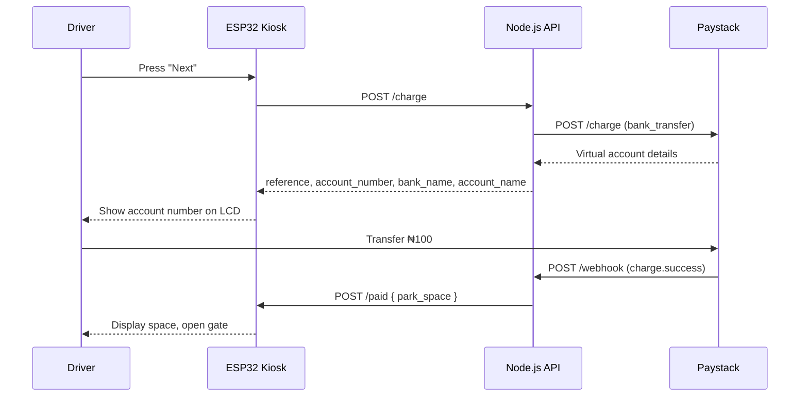

# Pay Park

**A smart car-park payment system: an ESP32 kiosk, a Node.js API, and Paystack bank-transfer payments.**


---

## Table of Contents

- [Overview](#overview)
- [Features](#features)
- [How It Works](#how-it-works)
- [Tech Stack](#tech-stack)
- [Hardware](#hardware)
- [Project Structure](#project-structure)
- [Getting Started](#getting-started)
- [API Reference](#api-reference)
- [Configuration](#configuration)
- [Deployment](#deployment)
- [License](#license)

---

## Overview

Pay Park lets a driver pay for a parking space at a physical kiosk, with no cash and no attendant.

1. The driver presses a button on the ESP32 kiosk.
2. The backend asks Paystack for a one-time virtual bank account and assigns a free parking space.
3. The kiosk shows the account number on its LCD. The driver pays **₦100** by bank transfer.
4. Paystack confirms the payment to the backend through a webhook.
5. The backend notifies the kiosk, which tells the driver which space to use and opens the gate.

## Features

- One-time virtual bank account per parking session (Paystack bank transfer, 30-minute expiry)
- 16x2 I2C LCD interface with a scrolling message line
- Two-button navigation (next / back) with audible feedback from a buzzer
- Servo-driven entry gate
- Automatic parking space assignment
- Instant gate release when the payment webhook arrives, plus manual re-check from the kiosk
- Device-side REST API built with [aWOT](https://github.com/lasselukkari/aWOT) (Express-style routing on the ESP32)

## How It Works



**Kiosk states**

| State | Description |
|---|---|
| `start` | Welcome screen. Waits for the driver to press **Next**. |
| `charge` | Requests a billing profile from the API. |
| `display_aza` | Shows the account number. **Next** re-checks payment, **Back** cancels. |
| `thanks` | Shows the assigned space, opens the gate, then returns to `start`. |

## Tech Stack

| Layer | Technology |
|---|---|
| Backend | Node.js, Express 5 (ES modules) |
| Payments | Paystack Charge API (bank transfer) |
| Firmware | Arduino framework on ESP32 |
| Firmware libraries | aWOT, ArduinoJson, ESP32Servo, LiquidCrystal_I2C, ESP32HTTPClient |
| Connectivity | Cloudflare Tunnel (exposes the ESP32 to the backend) |

## Hardware

| Component | Notes |
|---|---|
| ESP32 board | ESP-WROOM-32 (ESP32 Dev Module) |
| 16x2 LCD | I2C backpack, address `0x27` |
| Push buttons (x2) | Wired to ground, using internal pull-ups |
| Buzzer | Active buzzer |
| Servo motor | Gate actuator |

**Pin map**

| Function | GPIO |
|---|---|
| Next button | 13 |
| Back button | 14 |
| Buzzer | 26 |
| Servo signal | 4 |
| LCD SDA | 21 |
| LCD SCL | 22 |

## Project Structure

```
.
├── code.ino                 # ESP32 firmware
├── index.js                 # Express entry point
├── package.json
├── .gitignore
└── src/
    ├── routes.js            # Route definitions
    ├── controllers.js       # /charge controller and controller wiring
    ├── order.js             # In-memory order store
    ├── park_space.js        # In-memory parking space store
    └── functions/
        ├── charge.js        # Paystack integration
        ├── paid.js          # Payment status lookup
        └── webhook.js       # Paystack webhook handler and kiosk notifier
```

## Getting Started

### Prerequisites

- Node.js **20.6 or later** (needed for `--env-file`)
- A [Paystack](https://paystack.com) account and secret key
- Arduino IDE 2.x with ESP32 board support (Espressif)
- A Cloudflare account and a domain, if you want the backend to reach the kiosk (see [step 4](#4-expose-the-kiosk-to-the-backend))

### 1. Clone and install

```bash
git clone https://github.com/<your-username>/<your-repo>.git
cd <your-repo>
npm install
```

### 2. Configure and run the backend

Create a `.env` file in the project root:

```env
PAYSTACK_SECRET_KEY=sk_test_xxxxxxxxxxxxxxxxxxxxxxxx
```

Start the server:

```bash
# Development (auto-restart, loads .env)
npm test

# Production (environment variables must already be set)
npm start
```

The API listens on port `3000`. Check it at `http://localhost:3000/`.

> `npm start` does not load `.env`. On a host such as Render, set `PAYSTACK_SECRET_KEY` in the dashboard. To run it locally without nodemon, use `node --env-file=.env index.js`.

### 3. Flash the firmware

1. Install these libraries from the Arduino Library Manager: **aWOT**, **ArduinoJson** (7.x), **ESP32Servo**, **LiquidCrystal_I2C**, **ESP32HTTPClient**.
2. Open `code.ino` and set:
   ```cpp
   const char* WIFI_SSID = "YOUR_WIFI_NAME";
   const char* WIFI_PASS = "YOUR_WIFI_PASSWORD";
   ESP32HTTPClient client("https://<your-api-host>");
   ```
3. Select **ESP32 Dev Module** and your COM port, then upload.
4. Open the Serial Monitor at **115200** baud to see the kiosk's IP address.

### 4. Expose the kiosk to the backend

The backend calls the kiosk when a payment succeeds, so the kiosk must be reachable from the internet. Use a [Cloudflare Tunnel](https://developers.cloudflare.com/cloudflare-one/networks/connectors/cloudflare-tunnel/) running on a device on the same Wi-Fi network:

1. Give the ESP32 a fixed IP (DHCP reservation or static IP).
2. Create a tunnel and add a published application route:
   - **Hostname:** `<your-tunnel-hostname>`
   - **Service URL:** `http://<ESP32_IP>:80`
3. Update the notify URL in `src/functions/webhook.js` to `https://<your-tunnel-hostname>/paid/`.

### 5. Register the Paystack webhook

In the Paystack dashboard, go to **Settings → API Keys & Webhooks** and set the webhook URL to:

```
https://<your-api-host>/webhook
```

## API Reference

### Backend API

| Method | Endpoint | Description |
|---|---|---|
| `GET` | `/` | Health check and welcome message |
| `POST` | `/charge` | Create a payment session and assign a parking space |
| `GET` | `/paid/:reference` | Check whether a payment has been received |
| `POST` / `GET` | `/webhook` | Paystack webhook receiver |

#### `POST /charge`

Creates a ₦100 Paystack bank-transfer charge and reserves a space.

**Response `200`**

```json
{
  "reference": "string",
  "account_number": "string",
  "bank_name": "string",
  "account_name": "string",
  "expires_at": "2026-01-01T12:30:00.000Z"
}
```

**Response `500`**

```json
{ "error": "Failed to charge user" }
```

#### `GET /paid/:reference`

```bash
curl https://<your-api-host>/paid/<reference>
```

```json
{ "paid": true, "park_space_u": "A1" }
```

An unknown reference returns `{ "paid": false, "park_space_u": null }`.

#### `POST /webhook`

Expects a Paystack event payload:

```json
{
  "event": "charge.success",
  "data": { "reference": "string" }
}
```

On `charge.success` the order is marked paid, the space is marked occupied, and the kiosk is notified.

### Kiosk (ESP32) API

| Method | Endpoint | Description |
|---|---|---|
| `GET` | `/status` | Device status and uptime in seconds |
| `POST` | `/paid` | Tell the kiosk a payment succeeded |

```bash
curl http://<ESP32_IP>/status
# {"status":"ok","uptime":42}

curl -X POST http://<ESP32_IP>/paid \
  -H "Content-Type: application/json" \
  -d '{"park_space":"A1"}'
# {"message":"Payment recieved"}
```

## Configuration

| Setting | Location | Description |
|---|---|---|
| `PAYSTACK_SECRET_KEY` | `.env` / host environment | Paystack secret key |
| `PORT` | `index.js` | API port (default `3000`) |
| Parking spaces | `src/park_space.js` | List of spaces (default `A1` to `A5`) |
| Parking fee | `src/controllers.js` | Amount in naira passed to `chargeUser` (default `100`) |
| `WIFI_SSID`, `WIFI_PASS` | `code.ino` | Wi-Fi credentials |
| API base URL | `code.ino` | Backend address used by `ESP32HTTPClient` |
| `pollIntervalMs` | `code.ino` | Interval for automatic payment polling (disabled by default) |

## Deployment

The backend is a standard Node.js service and runs on any host that supports Node 20+, such as Render, Railway, or a VPS.

1. Set the start command to `npm start`.
2. Add `PAYSTACK_SECRET_KEY` as an environment variable.
3. Point the Paystack webhook at the deployed `/webhook` URL.

Free hosting tiers may put the service to sleep when idle, which delays the first request from the kiosk and clears in-memory data.

## License

Released under the [ISC License](https://opensource.org/licenses/ISC).

---

Built by **Osiaru Tech**.